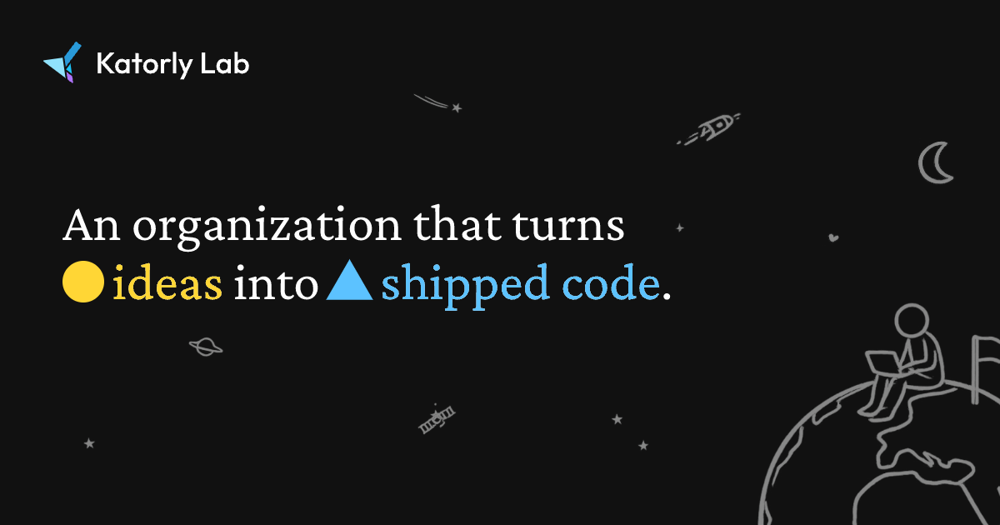

<!-- 

 -->

### `Katorly Lab`
Open source projects and samples from Katorly and partners, built to share knowledge and improve experience.

<a href="https://katorly.com">Website</a> ·
<a href="https://katorly.com/docs">Docs</a> ·
<a href="https://katorly.com/licenses">Licenses</a> ·
<a href="https://katorly.com/contact">Contact</a> ·
<a href="https://katorly.com/involving">Get Involved</a>

<!-- #### 📊 Statistics
    -->
